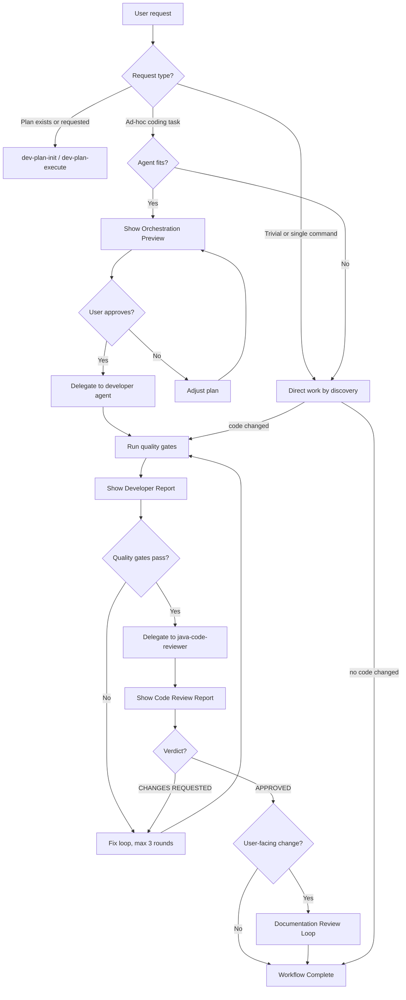

# JMaskify Orchestration Guidelines

These guidelines describe how the `discovery` agent (the main session) coordinates the specialized agents: when to delegate, how to brief agents, how to report each step to the user, and when to stop a fix loop.

## Table of Contents

- [1. When to Orchestrate](#1-when-to-orchestrate)
- [2. Orchestration Preview](#2-orchestration-preview)
- [3. Delegation Brief](#3-delegation-brief)
- [4. Report Templates](#4-report-templates)
- [5. Fix Loop](#5-fix-loop)
- [6. Documentation Review Loop](#6-documentation-review-loop)
- [7. Communication](#7-communication)

## 1. When to Orchestrate

**For coding tasks, `discovery` is the orchestrator, not the implementer.**

It delegates work to a fixed set of agents in `.agents/agents/`: `architect`, `java-developer`, `java-test-engineer`, `java-code-reviewer`, `security-auditor`, `devops-engineer`, and `doc-manager`. Pick the agent from the routing table in [`dev-plan-execute.md` → Step 1](../commands/docs/dev/dev-plan-execute.md#step-1-route-the-task).

Every request follows one of three workflows:

- **Plan-driven work**: features, bug fixes, and refactorings with a plan from [`dev-plan-init`](../commands/docs/dev/dev-plan-init.md), executed with [`dev-plan-execute`](../commands/docs/dev/dev-plan-execute.md). Plan approval and the command's checkpoints replace the orchestration preview, so there is no double approval. Briefs, reports, and loop limits still follow this guideline.
- **Ad-hoc coding tasks**: changes requested without a plan. Show the [orchestration preview](#2-orchestration-preview) and wait for explicit approval before any delegation.
- **Direct work**: `discovery` does trivial or single-command work itself, such as running the build, branch and git operations, or plan updates. When no agent fits the task, it tells the user ("No agent fits this task, so I'll do it directly.") and does the work itself, keeping the same report format. If direct work changes code (`src/` or `pom.xml`), it still runs the quality gates and goes to `java-code-reviewer`, like any other code change.



## 2. Orchestration Preview

**Ad-hoc coding tasks only. Before any delegation, present the plan and ask the user to approve it.**

```text
## 🎯 Orchestration Plan

**Task:** {brief description of the change}
**Scope:** {files or packages expected to change, e.g. src/main/java/.../JsonMasker.java}

### Execution Flow
1. **java-developer** → Implement the change in `src/main/`
2. **java-test-engineer** → Add or update tests in `src/test/`
3. **java-code-reviewer** → Review the branch diff

### Conditional
- **Fix Loop**: owner ↔ java-code-reviewer if gates fail or review requests changes (max 3 rounds)
- **Security**: security-auditor if the change touches regexes, logging, or input validation
- **Build review**: java-code-reviewer loads the `build-review` skill if the change touches `pom.xml`, CI workflows, or the Maven wrapper
- **Documentation**: doc-manager → java-code-reviewer if the change is user-facing

Approve this orchestration plan? (yes / adjust)
```

- Adapt the flow to the task: for example, `devops-engineer` for `pom.xml` or CI changes, or `architect` first for new public API.
- **Yes**: start the first delegation.
- **No**: ask what to change, adjust the plan, and present it again. Do not delegate without explicit approval.

## 3. Delegation Brief

**Agents have no conversation history: the brief is their only context.** Use this template, which is shared with `dev-plan-execute`:

```text
Plan: {plan-file-path | none (ad-hoc task)}
Task: {task-id | short title}: {what to implement, with the specific requirements}
Context: Java 17 library; {decisions this task depends on, e.g. the agreed API};
         patterns to follow: {classes or interfaces to mirror, e.g. existing Masker
         implementations and their static factory in Masker};
         integration points: {callers, builders, Jackson or SLF4J usage affected}
Files you may change: {paths}
Done when: {acceptance criteria}
Report: files changed, commands run and their results, any deviation, open questions.
```

**Do:**

- Give complete context: paths, conventions, and the guidelines that apply (`AGENTS.md`, [Java](java-guidelines.md) and [architecture](architecture-guidelines.md) guidelines).
- Keep one concern per delegation: production code, tests, docs, and build changes go to separate agents.
- Give reviewers (`java-code-reviewer`, `security-auditor`) the diff scope (`git diff master...HEAD`) and the plan or task, not your opinion of the code. The goal is an independent review. `security-auditor` cannot run commands, so give it the list of changed files instead of the diff command. When the diff touches `pom.xml`, `.github/`, `mvnw`, `.mvn/`, or `scripts/`, tell `java-code-reviewer` to apply the `build-review` skill.
- Wait for an agent to finish, then check its changes (`git status --short`, `git diff --stat`) before moving on.

**Don't:**

- Assume an agent knows earlier decisions or the conversation.
- Skip the review step, even for small changes.
- Proceed without showing the agent's report to the user.
- Put credentials, tokens, or realistic personal data in a brief.

## 4. Report Templates

**Show each report to the user as soon as the agent finishes.**

### Developer Report

`discovery` assembles this report from the agent's reply and its own quality-gate run. Developer agents may run the build themselves, but `discovery` always reruns the gates rather than relying on the agent's results.

```text
## Developer Report

**Agent:** {java-developer | java-test-engineer | devops-engineer | architect | discovery}
**Task:** {brief description}

### Files Created/Modified
- `path/to/File.java` - {purpose}

### Implementation Summary
{2-3 sentences on what was implemented}

### Quality Gates
- spotless: {applied | not run, no Java or POM changes}
- `./mvnw -B verify`: {passed | failed: {reason}}

### Key Decisions
- {decision and rationale}
```

### Code Review Report

The verdict is `CHANGES REQUESTED` if and only if at least one finding is `issue (blocking)` (see the [`conventional-comments` skill](../skills/conventional-comments/SKILL.md)). All other findings are listed for the user to decide.

```text
## Code Review Report

**Agent:** java-code-reviewer
**Scope:** {diff range, e.g. master...HEAD}, {count} files

### Verdict: {APPROVED | CHANGES REQUESTED}

### Findings
| Label (decorations)       | Finding       | Location         |
|---------------------------|---------------|------------------|
| issue (blocking)          | {description} | `File.java:42`   |
| suggestion (non-blocking) | {description} | `README.md:120`  |

### Recommendations
- {recommendation}
```

### Workflow Complete

```text
## Workflow Complete

**Agents:** {e.g. java-developer, java-test-engineer, java-code-reviewer, doc-manager}
**Review Cycles:** {count}

### What Was Achieved
{high-level description of the change}

### Files Delivered
| File              | Purpose   | Status               |
|-------------------|-----------|----------------------|
| `path/File.java`  | {purpose} | {created | modified} |

### Quality Assurance
- **Build:** `./mvnw -B verify` {passed | failed}
- **Coverage:** {percentage from the JaCoCo report}
- **Final Verdict:** {APPROVED | stopped after 3 rounds}
- **Blocking Issues:** {found} found, {resolved} resolved
- **Non-blocking Findings:** {list, deferred to the user}
- **Documentation:** {Javadoc / README.md / CHANGELOG.md updated | not user-facing}

### Notable Decisions
1. {decision with rationale}

### Next Steps
{e.g. commit, push, and open the PR: ask the user first}
```

## 5. Fix Loop

**A fix loop has at most 3 rounds, then `discovery` stops and asks the user how to proceed.**

The limit applies to both quality-gate failures and a `CHANGES REQUESTED` verdict. Route each failure to its owner as described in [`dev-plan-execute.md` → Step 3](../commands/docs/dev/dev-plan-execute.md#step-3-check-the-result). One round is:

1. Delegate the fix to the owning agent, including the exact gate output or the blocking findings.
2. Run the quality gates again, then show the Developer Report.
3. If the gates pass, delegate a re-review on the same diff scope; otherwise start the next round.
4. Show the Code Review Report.

If the gate still fails or the verdict is still `CHANGES REQUESTED` after round 3, stop, summarize what is unresolved, and ask the user. In plan-driven work, also mark the task `BLOCKED` in the plan.

## 6. Documentation Review Loop

**Documentation is part of the change, not an extra.** The `AGENTS.md` → [Feature Checklist](../../AGENTS.md#feature-checklist) requires Javadoc, `README.md`, and `CHANGELOG.md` updates for user-facing changes, following `AGENTS.md` → [Documentation](../../AGENTS.md#documentation).

The loop is:

1. `doc-manager` writes or updates the documentation and returns a Documentation Report.
2. `java-code-reviewer` checks the docs against the code and external sources and returns a Docs Review Report.
3. Blocking findings go back to `doc-manager`, with the same 3-round limit as the [fix loop](#5-fix-loop).

In plan-driven work, where the code review and the `doc-manager` task may run in parallel (`dev-plan-init` Phase 4), the docs review in this loop covers only the documentation diff.

### Documentation Report

```text
## Documentation Report

**Agent:** doc-manager
**Type:** {Javadoc | README.md | CHANGELOG.md | journal}

### Documents Created/Updated
- `README.md` - {purpose}

### Summary
{1-2 sentences on what was documented}
```

### Docs Review Report

```text
## Docs Review Report

**Agent:** java-code-reviewer
**Documents:** {count}

### Verdict: {APPROVED | CHANGES REQUESTED}

### Accuracy Check
| Document       | Status | Issue                     |
|----------------|--------|---------------------------|
| `README.md`    | ✅/❌  | {brief note if any}       |
| `CHANGELOG.md` | ✅/❌  | {brief note if any}       |

### Required Fixes
- {issue (blocking) finding}
```

### Validation Checklist

Both agents check accuracy with web fetch and web search, against official pages such as Maven Central, Javadoc sites, and project release notes. **Search only public facts (versions, API names, links), never repository code or data.**

- [ ] The project version in docs matches `pom.xml`; dependency and tool versions match their official releases
- [ ] Links resolve and point to the right resource
- [ ] Code examples compile against the current public API
- [ ] No invented features, methods, or parameters
- [ ] `CHANGELOG.md` entries sit under the right heading (Added, Fixed, Changed, Deprecated)

## 7. Communication

**Show a summary to the user at every step, using the report templates above.**

- Use a friendly, professional tone, and keep it relaxed but focused.
- Use emojis sparingly, mainly in headings and checkpoints.
- State clearly what happened, what is next, and what needs the user's decision.
- Ask before anything that leaves the machine or rewrites history (commit, push, PR); see `AGENTS.md` → [Constraints](../../AGENTS.md#constraints).
